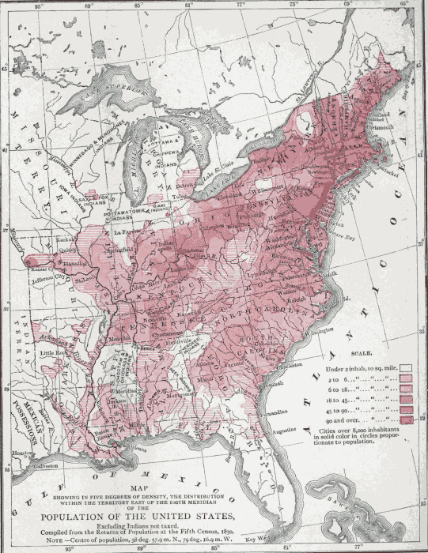
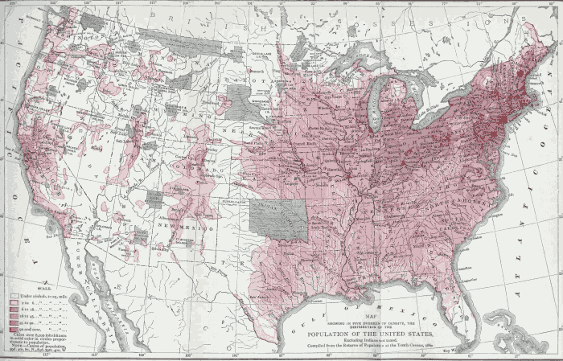

# Preface.

An experience of five years with Mr. Mill's treatise in the class-room not only convinced me of the great usefulness of
what still remains one of the most lucid and systematic books yet published which cover the whole range of the study,
but I have also been convinced of the need of such additions as should give the results of later thinking, without
militating against the general tenor of Mr. Mill's system; of such illustrations as should fit it better for American
students, by turning their attention to the application of principles in the facts around us; of a bibliography which
should make it easier to get at the writers of other schools who offer opposing views on controverted questions; and of
some attempts to lighten those parts of his work in which Mr. Mill frightened away the reader by an appearance of too
great abstractness, and to render them, if possible, more easy of comprehension to the student who first approaches
Political Economy through this author. Believing, also, that the omission of much that should properly be classed under
the head of Sociology, or Social Philosophy, would narrow the field to Political Economy alone, and aid, perhaps, in
\[pg iv\] clearer ideas, I was led to reduce the two volumes into one, with, of course, the additional hope that the
smaller book would tempt some readers who might hesitate to attack his larger work. In consonance with the above plan, I
have abridged Mr. Mill's treatise, yet have always retained his own words; although it should be said that they are not
always his consecutive words. Everything in the larger type on the page is taken literally from Mr. Mill, and, whenever
it has been necessary to use a word to complete the sense, it has been always inserted in square brackets. All
additional matter introduced by me has been printed in a smaller but distinctive type. The reader can see at a glance
which part of the page is Mr. Mill's and which my own.

It has seemed necessary to make the most additions to the original treatise under the subjects of the Wages Question; of
Wages of Superintendence; of Socialism; of Cost of Production; of Bimetallism; of the Paper Money experiments in this
country; of International Values; of the Future of the Laboring-Classes (in which the chapter was entirely rewritten);
and of Protection. The treatment of Land Tenures has not been entirely omitted, but it does not appear as a separate
subject, because it has at present less value as an elementary study for American students. The chapters on Land
Tenures, the English currency discussion, and much of Book V, on the Influence of Government, have been simply omitted.
In one case I have changed the order of the chapters, by inserting Chap. XV of Book III, treating of a standard of
value, under the chapter treating of money and its functions. In other respects, the same order has been followed as in
the original work.

Wherever it has seemed possible, American illustrations have been inserted instead of English or Continental ones.

\[pg v\]

To interest the reader in home problems, twenty-four charts have been scattered throughout the volume, which bear upon
our own conditions, with the expectation, also, that the different methods of graphic representation here presented
would lead students to apply them to other questions. They are mainly such as I have employed in my class-room. The use
and preparation of such charts ought to be encouraged. The earlier pages of the volume have been given up to a “Sketch
of the History of Political Economy,” which aims to give the story of how we have arrived at our present knowledge of
economic laws. The student who has completed Mill will then have a very considerable bibliography of the various schools
and writers from which to select further reading, and to select this reading so that it may not fall wholly within the
range of one class of writers. But, for the time that Mill is being first studied, I have added a list of the most
important books for consultation. I have also collected, in Appendix I, some brief bibliographies on the Tariff, on
Bimetallism, and on American Shipping, which may be of use to those who may not have the means of inquiring for
authorities, and in Appendix II a number of questions and problems for the teacher's use.

In some cases I have omitted Mr. Mill's statement entirely, and put in its stead a simpler form of the same exposition
which I believed would be more easily grasped by a student. Of such cases, the argument to show that Demand for
Commodities is not Demand for Labor, the Doctrine of International Values, and the Effect of the Progress of Society on
wages, profits, and rent, are examples. Whether I have succeeded or not, must be left for the experience of the teacher
to determine. Many small figures and diagrams have been used throughout the text, in order \[pg vi\] to suggest the
concrete means of getting a clear grasp of a principle.

In conclusion, I wish to acknowledge my indebtedness to several friends for assistance in the preparation of this
volume, among whom are Professor Charles F. Dunbar, Dr. F. W. Taussig, Dr. A. B. Hart, and Mr. Edward Atkinson.

J. Laurence Laughlin.  
Harvard University, Cambridge, Massachusetts,  
September, 1884.

Chart I

Chart II

\[pg 001\]

* * *
