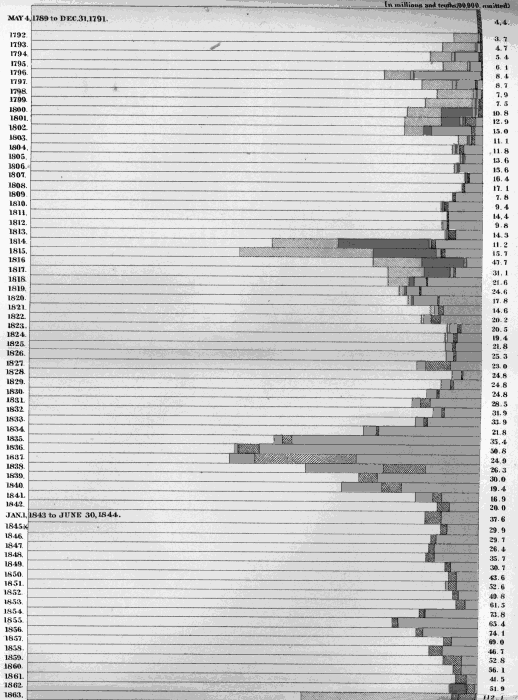
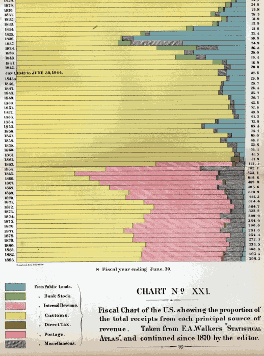

# Charts.

Chart XII. Fluctuations in the Price of Gold, from January 1st 1862, to December, 1865.

\[pg 662\]

Chart XVIII. Graphical Presentation of the Comparative Areas of the States and Territories of the United States and the
Countries of Europe, omitting Russia and Alaska.

\[pg 663\]

Chart XIX. Giving the actual figures, compiled from the accounts of two Cotton-Mills in New England by Edward Atkinson,
of Wages, Cost of Labor, etc., from 1830 to 1884, working on Standard Sheetings, No. 14 yarn.

\[pg 664\]

Chart XX. Comparison of 1840 with 1883-1884, of the Relations of Labor and Capital in the same Mills.

\[pg 665\]

Chart XXI Part 1.

\[pg 666\]

Chart XXI Part 2.

\[pg 667\]

Chart XXII. Outstanding Principal Of The Public Debt From 1791 To 1881.
